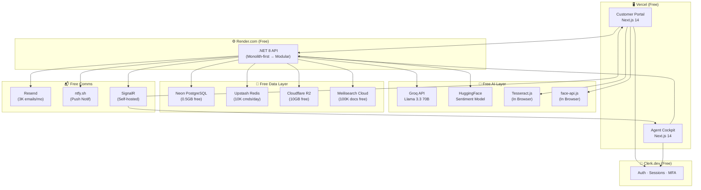

# 🏦 Banking Onboarding & AI Support Platform — Zero Budget Plan

> **\$0 Budget · 100% Free Tier · Open Source First**  
> **Stack:** Next.js 14 · .NET 8 · Groq API · HuggingFace · Neon · Upstash · Vercel · Render · Cloudflare

---

## 💡 Free-Tier Philosophy

> [!IMPORTANT]
> Every service below has a **permanently free tier** (not just a trial). No credit card surprises. The plan is designed so the entire MVP can run indefinitely at \$0.

---

## 🧱 Zero-Budget Tech Stack

```mermaid
flowchart TD
    subgraph Free_Frontend["🖥️ Frontend — FREE"]
        NX["Next.js 14\n(Open Source)"]
        VERCEL["Vercel Hobby\n100GB bandwidth/mo · Free"]
        SHADCN["shadcn/ui + Tailwind\n(Open Source)"]
    end

    subgraph Free_Backend[".NET 8 Backend — FREE"]
        DOTNET[".NET 8 ASP.NET Core\n(Open Source · MIT)"]
        RENDER["Render.com Free\n750 hrs/month · 512MB RAM"]
        FLY["Fly.io Free\n3 shared VMs · 256MB each"]
    end

    subgraph Free_Auth["🔐 Auth — FREE"]
        CLERK["Clerk.dev\n10,000 MAU Free Forever"]
        NXTAUTH["NextAuth.js\n(Open Source)"]
    end

    subgraph Free_AI["🤖 AI — FREE"]
        GROQ["Groq API\nLlama 3.3 70B · Free Tier\n6000 tokens/min"]
        HF["HuggingFace\nInference API · Free\n(Sentiment, NER, Classification)"]
        TESS["Tesseract.js\nBrowser OCR · Open Source"]
        FACEAPI["face-api.js\nBrowser Liveness · Open Source"]
    end

    subgraph Free_Data["💾 Data — FREE"]
        NEON["Neon PostgreSQL\n0.5 GB · Free Forever"]
        UPSTASH["Upstash Redis\n10,000 cmds/day · Free"]
        CF_R2["Cloudflare R2\n10 GB Storage\n0 Egress Fees · Free"]
        SUP_STORE["Supabase Storage\n1 GB · Free"]
    end

    subgraph Free_Comms["📬 Comms — FREE"]
        RESEND["Resend Email\n3,000 emails/month · Free"]
        NTFY["ntfy.sh\nPush Notifications · Free & OSS"]
        WS["SignalR\nSelf-hosted · Open Source"]
    end

    subgraph Free_Ops["📊 Ops — FREE"]
        GHA["GitHub Actions\n2,000 min/month · Free"]
        SENTRY["Sentry.io\n5,000 errors/month · Free"]
        GRAFANA["Grafana Cloud\n10K metrics/month · Free"]
        UPT["UptimeRobot\n50 monitors · Free"]
    end

    NX --> VERCEL
    DOTNET --> RENDER
    VERCEL --> CLERK
    RENDER --> NEON
    RENDER --> UPSTASH
    RENDER --> CF_R2
    RENDER --> GROQ
    RENDER --> HF
    NX --> TESS
    NX --> FACEAPI
    RENDER --> RESEND
    GHA --> RENDER
```



---

## 📦 Complete Free Service Registry

### 🖥️ Frontend & Hosting

| Service | Free Tier | Use In Project | Link |
|---|---|---|---|
| **Next.js 14** | Open Source (MIT) | Full frontend framework | nextjs.org |
| **Vercel Hobby** | Unlimited deploys, 100GB BW/mo, Custom domain | Hosting Next.js app | vercel.com |
| **shadcn/ui** | Open Source | UI component library | ui.shadcn.com |
| **Tailwind CSS** | Open Source | Styling | tailwindcss.com |
| **Zustand** | Open Source | State management | zustand |
| **React Hook Form + Zod** | Open Source | Form validation | — |
| **Framer Motion** | Open Source (MIT) | Animations | framer.com/motion |
| **Recharts** | Open Source | Charts & analytics | recharts.org |

---

### ⚙️ Backend & Runtime

| Service | Free Tier | Use In Project | Limits |
|---|---|---|---|
| **.NET 8 ASP.NET Core** | Open Source (MIT) | All microservices | Unlimited |
| **Render.com** | 750 hrs/month, 512MB RAM | Host .NET services | Spins down after 15min inactivity |
| **Fly.io** | 3 shared-cpu-1x VMs (256MB each) | Alternative backend host | 3GB volume storage |
| **Railway.app** | \$5 credit/month (hobby) | Alt: Deploy .NET + DB together | ~500hrs usage |

> [!TIP]
> **Render spin-down workaround**: Add a free UptimeRobot monitor that pings your Render service every 14 minutes — keeps it warm 24/7 at no cost.

---

### 🔐 Authentication

| Service | Free Tier | Use In Project |
|---|---|---|
| **Clerk.dev** | 10,000 Monthly Active Users, Social login, MFA, Passkeys | Customer + Agent auth with zero backend auth code |
| **NextAuth.js** | Open Source | Fallback: self-managed JWT sessions |

**Why Clerk over building custom auth:**
- Pre-built UI components (sign-in, sign-up, MFA) = weeks saved
- Handles JWT, refresh tokens, session management
- Free TOTP, passkeys, social OAuth (Google, GitHub)
- Dashboard for user management at no cost

---

### 🤖 AI & ML (All Free)

| Service | Model | Free Tier | Use In Project |
|---|---|---|---|
| **Groq API** | Llama 3.3 70B, Mixtral 8x7B | 6,000 tokens/min, 500K tokens/day | Ticket summarization, response generation, NBA |
| **HuggingFace Inference API** | DistilBERT, RoBERTa, BERT | 30K chars/month per model | Sentiment analysis, text classification |
| **Tesseract.js** | — (runs in browser/Node) | Open Source (Apache 2.0) | KYC document OCR |
| **face-api.js** | TinyFaceDetector, AgeGender | Open Source (MIT) | Liveness / face detection |
| **LangChain.js / LangChain.NET** | — | Open Source | RAG orchestration |
| **Meilisearch Cloud** | 100K documents, 10K searches/month | Free | Semantic ticket search |

#### Groq vs AWS Bedrock — Why Groq is better for \$0

| Feature | Groq (Free) | AWS Bedrock |
|---|---|---|
| Cost | \$0 forever | ~\$0.003/1K tokens |
| Speed | Fastest inference on earth (LPU chips) | Standard GPU speed |
| Model | Llama 3.3 70B (excellent for tasks) | Claude 3 Haiku (better but paid) |
| Rate Limit | 6,000 TPM | Paid per token |

---

### 💾 Database & Storage

| Service | Free Tier | Use In Project | Limits |
|---|---|---|---|
| **Neon PostgreSQL** | 0.5 GB storage, 1 compute unit | Core relational data | Branches for dev/staging (free) |
| **Upstash Redis** | 10,000 commands/day, 256MB | Caching, sessions, rate limiting | Serverless, pay-per-use after |
| **Cloudflare R2** | 10 GB storage, 10M Class A ops/month | KYC document storage | Zero egress fees (key advantage!) |
| **Supabase** | 500MB DB, 1GB storage, 50MB file uploads | Alt: everything-in-one (DB + storage + auth + realtime) | 2 free projects |

> [!NOTE]
> **Cloudflare R2 vs AWS S3**: R2 is strictly better for \$0 — same S3-compatible API, **zero egress fees** (S3 charges per GB downloaded), 10GB free. Your .NET SDK just points to R2 endpoint.

---

### 📬 Communications

| Service | Free Tier | Use In Project |
|---|---|---|
| **Resend** | 3,000 emails/month, 100/day | Approval/rejection/OTP emails |
| **Brevo (Sendinblue)** | 300 emails/day, unlimited contacts | Backup email provider |
| **ntfy.sh** | Open Source, self-hostable | In-app push notifications (no Firebase needed) |
| **SignalR (self-hosted)** | Open Source (.NET) | Real-time WebSocket status updates |

---

### 📊 Observability & Monitoring

| Service | Free Tier | Use In Project |
|---|---|---|
| **Sentry.io** | 5,000 errors/month, 1 project | Error tracking (frontend + backend) |
| **Grafana Cloud** | 10K series, 50GB logs, 14-day retention | Metrics dashboards |
| **UptimeRobot** | 50 monitors, 5-min intervals | Service uptime alerts |
| **GitHub Actions** | 2,000 min/month (public repo) | Full CI/CD pipeline |

---

## 🏗️ Revised Architecture (Zero Budget)



---

## 🔄 Revised Module Architecture

### MODULE 1 — Customer Portal

#### 1.1 Registration & Profile (Free Stack)

```
Next.js → Clerk.dev sign-up widget (pre-built, free)
       → POST /api/users → .NET API → Neon PostgreSQL
       → Welcome email → Resend
```

**Free Unique Features:**
- 🤳 **Browser-Side Liveness** — `face-api.js` runs entirely in the browser; no paid API call
- 📄 **In-Browser OCR** — `Tesseract.js` extracts text from uploaded docs before sending to server
- 🧠 **Progressive Profile** — Clerk handles identity; custom DB stores banking-specific profile fields
- 🔑 **Social Login Free** — Clerk provides Google/GitHub OAuth at zero cost

---

#### 1.2 Product Applications (Free Stack)

```
Dynamic Form (JSON schema in Neon PostgreSQL)
→ React Hook Form + Zod (browser validation)
→ POST /api/applications → .NET → Neon
→ Groq Llama 3.3 → Eligibility Pre-Screening
→ SLA tracked via Upstash Redis TTL keys
→ Resend email notification
```

**Free AI Eligibility Screener Prompt (Groq):**
> "Given customer profile data: age={age}, employment={status}, documents_verified={bool}, assess eligibility for {product} and return: score (0-100), recommendation, and 3 reasons. Respond in JSON."

---

#### 1.3 KYC Document Upload (Free Stack)

```
Browser → Tesseract.js OCR (extract text locally, free)
        → face-api.js (face detection on selfie, free)
        → Pre-signed URL from .NET API
        → Cloudflare R2 (10GB free, zero egress)
        → Metadata → Neon PostgreSQL
        → Validation result → Resend email
```

**Key Free Tech Decisions:**

| Paid Original | Free Replacement | Trade-off |
|---|---|---|
| AWS Textract | Tesseract.js (browser) | Slightly less accurate; runs client-side |
| AWS Rekognition | face-api.js (browser) | No cloud call needed at all |
| AWS S3 | Cloudflare R2 | Same API, better (no egress fees) |

---

#### 1.4 Application Status Tracking (Free Stack)

```
Customer Dashboard → GET /api/applications/{id}
                  → Neon PostgreSQL (status query)
                  → SignalR Hub (.NET self-hosted on Render)
                  → Real-time push to browser WebSocket
                  → ntfy.sh push notification (mobile)
```

**Visual Journey Map:** Built entirely with Tailwind CSS + Framer Motion — no paid charting library needed.

---

#### 1.5 Approval / Rejection Notifications (Free Stack)

```
Workflow completion → .NET triggers Resend API
                   → HTML email template (approval/rejection)
                   → ntfy.sh (mobile push)
                   → SignalR (in-app real-time banner)
                   → PDF generated by QuestPDF (.NET OSS library)
```

> [!NOTE]
> **QuestPDF** is a free, open-source .NET library for generating professional PDFs — approval certificates, rejection reports, audit trails — with zero licensing cost.

---

### MODULE 2 — AI Agent Cockpit (Free Stack)

#### 2.1 Ticket Summarization (Groq — Free)

**Free Implementation:**

```csharp
// .NET AI Service — Groq HTTP client (free)
var groqRequest = new {
    model = "llama-3.3-70b-versatile", // free tier
    messages = new[] {
        new { role = "system", content = SUMMARIZATION_PROMPT },
        new { role = "user",   content = ticketThread }
    },
    response_format = new { type = "json_object" }
};
// Returns: { summary, issue_type, urgency, sentiment_hint, tags[] }
```

**Free Unique Features:**
- 🏷️ Auto-tagging via Groq JSON mode (no extra cost)
- 🔗 Similar tickets via Meilisearch vector search (free 100K docs)
- 🌐 Auto-translation via HuggingFace Helsinki-NLP models (free)

---

#### 2.2 Suggested Response Generation (Groq RAG — Free)

**Free RAG Pipeline:**

```
Agent opens ticket
→ Meilisearch: find top-3 similar resolved tickets (free)
→ Load relevant policy sections from Neon DB
→ Groq Llama 3.3: generate 3 responses (Formal/Empathetic/Concise)
→ Stream response to Agent Cockpit (SSE streaming, free)
```

```
Policy Docs stored as: Neon PostgreSQL (text chunks + embedding column)
Embedding model: HuggingFace sentence-transformers/all-MiniLM-L6-v2 (free)
Vector search: pgvector extension on Neon (free, included)
```

> [!TIP]
> **Neon + pgvector** gives you a full vector database for RAG at zero cost. Store policy doc embeddings directly in PostgreSQL — no Pinecone or Weaviate subscription needed.

---

#### 2.3 Sentiment Analysis (HuggingFace — Free)

**Free Pipeline:**

```
Ticket text → HuggingFace Inference API (free)
            → Model: cardiffnlp/twitter-roberta-base-sentiment-latest
            → Returns: { positive, negative, neutral } probabilities
            → .NET maps to: Churn Risk Score (rule-based formula)
            → If churn_risk > 0.7 → ntfy.sh alert to supervisor
```

**Churn Risk Formula (rule-based, no ML cost):**
```
churn_risk = (negative_sentiment × 0.5) 
           + (ticket_count_30days × 0.3) 
           + (days_since_last_positive × 0.2)
```

**HuggingFace Free Models Used:**

| Task | Model | Free Tier |
|---|---|---|
| Sentiment | cardiffnlp/twitter-roberta-base-sentiment-latest | 30K chars/month |
| Emotion detection | j-hartmann/emotion-english-distilroberta-base | 30K chars/month |
| Language detection | papluca/xlm-roberta-base-language-detection | 30K chars/month |
| Translation | Helsinki-NLP/opus-mt-{src}-en | 30K chars/month |

---

#### 2.4 Next-Best Actions (Rule Engine + Groq — Free)

**Free NBA Implementation:**

```csharp
// Step 1: Rule Engine (.NET) — zero cost
var rules = new NBARule[] {
    new("UPGRADE_OFFER", when: c => c.Tenure > 365 && c.ProductCount < 3),
    new("WAIVE_FEE",     when: c => c.SentimentScore < 0.3 && c.IsGoodStanding),
    new("ESCALATE",      when: c => c.TicketCount > 5 && c.ChurnRisk > 0.7),
    new("SCHEDULE_CALL", when: c => c.LastContact > 30),
};

// Step 2: Groq enriches each action with predicted outcome
// "Given customer context, rate the success probability of: {action}"
```

**NBA Action Cards UI** — Built with shadcn/ui Card components, no paid UI library.

---

## 🗄️ Database Schema (Neon Free Tier — 0.5GB)

> [!IMPORTANT]
> **Storage Budget for 0.5GB Neon free tier:**
> - 10,000 customers × avg 2KB profile data = ~20MB
> - 50,000 application records × 5KB = ~250MB
> - 100,000 audit events × 1KB = ~100MB
> - Policy chunks for RAG (pgvector) = ~50MB
> - Remaining buffer = ~80MB
>
> This comfortably supports a full MVP demo and assessment.

```sql
-- Core schema (Neon PostgreSQL, free tier)

-- Enable pgvector for RAG (free extension on Neon)
CREATE EXTENSION IF NOT EXISTS vector;

CREATE TABLE customers (
    id UUID PRIMARY KEY DEFAULT gen_random_uuid(),
    clerk_user_id VARCHAR(255) UNIQUE NOT NULL, -- Clerk manages auth
    email VARCHAR(255) UNIQUE NOT NULL,
    phone VARCHAR(20),
    security_level SMALLINT DEFAULT 1,
    status VARCHAR(50) DEFAULT 'pending_kyc',
    created_at TIMESTAMPTZ DEFAULT NOW()
);

CREATE TABLE profiles (
    id UUID PRIMARY KEY DEFAULT gen_random_uuid(),
    customer_id UUID REFERENCES customers(id),
    full_name VARCHAR(255),
    dob DATE,
    pan_number VARCHAR(10),         -- stored hashed
    aadhaar_hash VARCHAR(64),       -- SHA-256 only, never plaintext
    address JSONB,
    ocr_extracted_data JSONB        -- raw OCR output from Tesseract
);

CREATE TABLE kyc_documents (
    id UUID PRIMARY KEY DEFAULT gen_random_uuid(),
    customer_id UUID REFERENCES customers(id),
    doc_type VARCHAR(50),           -- 'aadhaar', 'pan', 'selfie', 'payslip'
    r2_object_key VARCHAR(500),     -- Cloudflare R2 key (not full URL)
    ocr_text TEXT,                  -- Tesseract.js output
    face_detected BOOLEAN,          -- face-api.js result
    status VARCHAR(50) DEFAULT 'uploaded',
    version SMALLINT DEFAULT 1,
    uploaded_at TIMESTAMPTZ DEFAULT NOW()
);

CREATE TABLE applications (
    id UUID PRIMARY KEY DEFAULT gen_random_uuid(),
    customer_id UUID REFERENCES customers(id),
    product_type VARCHAR(100),
    status VARCHAR(50) DEFAULT 'draft',
    form_data JSONB,
    ai_eligibility_score SMALLINT,  -- 0-100 from Groq
    sla_deadline TIMESTAMPTZ,
    current_stage VARCHAR(100),
    created_at TIMESTAMPTZ DEFAULT NOW()
);

CREATE TABLE tickets (
    id UUID PRIMARY KEY DEFAULT gen_random_uuid(),
    customer_id UUID REFERENCES customers(id),
    channel VARCHAR(50),
    raw_text TEXT,
    ai_summary TEXT,                -- Groq output
    tags TEXT[],                    -- Groq auto-tags
    sentiment_label VARCHAR(20),    -- HuggingFace output
    sentiment_score DECIMAL(4,3),
    churn_risk DECIMAL(4,3),
    status VARCHAR(50) DEFAULT 'open',
    created_at TIMESTAMPTZ DEFAULT NOW()
);

-- RAG: Policy document chunks with vector embeddings
CREATE TABLE policy_chunks (
    id UUID PRIMARY KEY DEFAULT gen_random_uuid(),
    document_name VARCHAR(255),
    chunk_text TEXT,
    embedding VECTOR(384),          -- all-MiniLM-L6-v2 dimensions
    created_at TIMESTAMPTZ DEFAULT NOW()
);
CREATE INDEX ON policy_chunks USING ivfflat (embedding vector_cosine_ops);

CREATE TABLE audit_events (
    id UUID PRIMARY KEY DEFAULT gen_random_uuid(),
    entity_type VARCHAR(50),
    entity_id UUID,
    actor_id VARCHAR(255),
    action VARCHAR(100),
    metadata JSONB,
    created_at TIMESTAMPTZ DEFAULT NOW()
);
```

---

## ☁️ Deployment Architecture (Zero Cost)

```mermaid
flowchart LR
    subgraph Dev["👨‍💻 Development"]
        LOCAL[".NET 8 (local)\nNext.js (local)\nDocker Compose\n(Postgres + Redis local)"]
    end

    subgraph Staging["🧪 Staging (Free)"]
        VERCEL_P["Vercel Preview\n(auto on PR)"]
        RENDER_S["Render Free\n(staging instance)"]
        NEON_B["Neon Branch\n(DB branch per PR, free)"]
    end

    subgraph Prod["🚀 Production (Free)"]
        VERCEL_PROD["Vercel Hobby\nNext.js Production"]
        RENDER_PROD["Render Free\n.NET 8 Service"]
        NEON_PROD["Neon PostgreSQL\nProduction DB"]
        UPSTASH_P["Upstash Redis"]
        R2_P["Cloudflare R2\nDocument Store"]
        MEILI_P["Meilisearch Cloud"]
    end

    subgraph CICD["🔄 CI/CD (GitHub Actions — Free)"]
        GHA_S["On PR → lint + test + deploy staging"]
        GHA_P["On main merge → deploy production"]
    end

    LOCAL --> CICD
    CICD --> Staging
    Staging --> Prod
```



### Render.com Free Tier Strategy

```yaml
# render.yaml — Infrastructure as Code (free)
services:
  - type: web
    name: incedo-bank-api
    runtime: dotnet
    buildCommand: dotnet publish -c Release -o out
    startCommand: dotnet out/IncedoBank.API.dll
    plan: free
    envVars:
      - key: ASPNETCORE_ENVIRONMENT
        value: Production
      - key: DATABASE_URL
        fromDatabase:
          name: incedo-bank-db
          property: connectionString
```

> [!WARNING]
> **Render Free Limitation**: Services sleep after 15 minutes of inactivity. Mitigation: Set up a free UptimeRobot monitor to ping `/health` every 10 minutes. This is a valid assessment/demo strategy.

---

## 🔄 CI/CD Pipeline (GitHub Actions — Free)

```yaml
# .github/workflows/deploy.yml

name: CI/CD Pipeline

on:
  pull_request:
    branches: [main]
  push:
    branches: [main]

jobs:
  test-backend:
    runs-on: ubuntu-latest           # Free runner
    steps:
      - uses: actions/checkout@v4
      - uses: actions/setup-dotnet@v4
        with: { dotnet-version: '8.0.x' }
      - run: dotnet test --no-build --verbosity normal

  test-frontend:
    runs-on: ubuntu-latest
    steps:
      - uses: actions/checkout@v4
      - uses: actions/setup-node@v4
        with: { node-version: '20' }
      - run: npm ci && npm run lint && npm test

  deploy-staging:
    needs: [test-backend, test-frontend]
    if: github.event_name == 'pull_request'
    runs-on: ubuntu-latest
    steps:
      - name: Deploy to Render (staging)
        run: curl -X POST ${{ secrets.RENDER_STAGING_DEPLOY_HOOK }}

  deploy-prod:
    needs: [test-backend, test-frontend]
    if: github.ref == 'refs/heads/main'
    runs-on: ubuntu-latest
    steps:
      - name: Deploy to Render (prod)
        run: curl -X POST ${{ secrets.RENDER_PROD_DEPLOY_HOOK }}
      - name: Deploy to Vercel (prod)
        run: npx vercel --prod --token=${{ secrets.VERCEL_TOKEN }}
```

---

## 🔒 Security (All Free)

| Layer | Free Solution |
|---|---|
| **Authentication** | Clerk.dev (MFA, JWT, session rotation — all free) |
| **HTTPS/TLS** | Vercel & Render provide free TLS certificates automatically |
| **Secrets Management** | GitHub Actions Secrets + Render Environment Variables |
| **Input Validation** | Zod (frontend) + FluentValidation (backend) — both OSS |
| **Rate Limiting** | ASP.NET Core rate limiting middleware (built-in, free) |
| **SQL Injection** | EF Core parameterized queries (built-in) |
| **XSS Protection** | Next.js built-in CSP headers |
| **Document Privacy** | Cloudflare R2 private buckets + pre-signed URLs |
| **PAN/Aadhaar** | Store only SHA-256 hash (never plaintext) |
| **Dependency Scanning** | GitHub Dependabot (free for public repos) |
| **SAST** | GitHub CodeQL (free for public repos) |

---

## 📅 Timeline (12 Weeks — Zero Budget)

### Phase 1 — Setup & Auth (Week 1–2)
- [ ] GitHub repo + GitHub Actions CI pipeline
- [ ] Neon PostgreSQL setup + Prisma/EF Core migrations
- [ ] Clerk.dev integration (Next.js + .NET JWT verification)
- [ ] Cloudflare R2 bucket setup + pre-signed URL API
- [ ] Upstash Redis connection
- [ ] Render.com deployment of .NET API
- [ ] Vercel deployment of Next.js app
- [ ] UptimeRobot keep-alive setup

### Phase 2 — Customer Portal (Week 3–6)
- [ ] KYC upload: Tesseract.js OCR in browser → R2 storage
- [ ] face-api.js selfie liveness check
- [ ] Dynamic form engine (JSON schema in Neon)
- [ ] Application workflow + SLA tracking (Upstash Redis TTL)
- [ ] SignalR real-time hub (self-hosted on Render)
- [ ] Resend email notifications (approval/rejection templates)
- [ ] ntfy.sh push notifications
- [ ] QuestPDF approval certificate generation
- [ ] Customer dashboard UI (Next.js + shadcn/ui)

### Phase 3 — AI Agent Cockpit (Week 7–10)
- [ ] Groq API integration (ticket summarization, response generation)
- [ ] HuggingFace sentiment pipeline
- [ ] pgvector + policy doc embeddings (RAG with all-MiniLM-L6-v2)
- [ ] Meilisearch ticket indexing + semantic search
- [ ] NBA rule engine (.NET)
- [ ] Agent Cockpit UI: ticket view, AI panel, sentiment widget, NBA cards
- [ ] Streaming responses (SSE) from Groq to Agent UI
- [ ] Multilingual support (HuggingFace translation models)

### Phase 4 — Polish & Demo (Week 11–12)
- [ ] Sentry error tracking (frontend + backend)
- [ ] Grafana Cloud dashboard (key metrics)
- [ ] Load testing with k6 (free, OSS)
- [ ] README + architecture docs
- [ ] Seed data for demo
- [ ] Presentation deck

---

## 🧪 Testing Strategy (All Free Tools)

| Layer | Tool | Free Tier |
|---|---|---|
| Unit Tests (.NET) | xUnit (OSS) | Unlimited |
| Unit Tests (JS) | Vitest / Jest (OSS) | Unlimited |
| API Testing | Bruno (OSS Postman alternative) | Unlimited |
| E2E Tests | Playwright (OSS, Microsoft) | Unlimited |
| Load Testing | k6 (OSS, Grafana) | Unlimited |
| Coverage | Coverlet (.NET, OSS) | Unlimited |

---

## 💰 Total Cost Breakdown

| Category | Service | Monthly Cost |
|---|---|---|
| Frontend Hosting | Vercel Hobby | **\$0** |
| Backend Hosting | Render.com | **\$0** |
| Database | Neon PostgreSQL | **\$0** |
| Cache | Upstash Redis | **\$0** |
| Document Storage | Cloudflare R2 | **\$0** |
| Authentication | Clerk.dev | **\$0** |
| AI / LLM | Groq API | **\$0** |
| AI / NLP | HuggingFace Inference | **\$0** |
| OCR | Tesseract.js | **\$0** |
| Liveness | face-api.js | **\$0** |
| Search | Meilisearch Cloud | **\$0** |
| Email | Resend | **\$0** |
| Push Notifications | ntfy.sh | **\$0** |
| CI/CD | GitHub Actions | **\$0** |
| Error Tracking | Sentry.io | **\$0** |
| Monitoring | Grafana Cloud | **\$0** |
| Uptime | UptimeRobot | **\$0** |
| **TOTAL** | | **\$0 / month** |

---

## 📁 Project Folder Structure

```
incedo-bank/
├── frontend/                        # Next.js 14
│   ├── src/
│   │   ├── app/
│   │   │   ├── (customer)/
│   │   │   │   ├── register/        # Clerk sign-up + profile setup
│   │   │   │   ├── dashboard/       # Application tracker
│   │   │   │   ├── apply/[product]/ # Dynamic form engine
│   │   │   │   ├── kyc/             # Tesseract OCR + face-api upload
│   │   │   │   └── notifications/
│   │   │   ├── (agent)/
│   │   │   │   ├── cockpit/         # AI Agent dashboard
│   │   │   │   └── tickets/[id]/   # Groq AI panel
│   │   │   └── api/                 # Next.js API routes (BFF)
│   │   ├── components/
│   │   │   ├── kyc/                 # OCR + webcam components
│   │   │   ├── ai/                  # Sentiment widget, NBA cards
│   │   │   └── ui/                  # shadcn/ui components
│   │   └── lib/
│   │       ├── tesseract/           # OCR helpers
│   │       ├── face-api/            # Liveness detection
│   │       └── groq/                # Client-side streaming helpers
│   └── package.json
│
├── backend/                         # .NET 8
│   ├── src/
│   │   ├── IncedoBank.API/          # Main ASP.NET Core app
│   │   │   ├── Controllers/
│   │   │   │   ├── AuthController.cs
│   │   │   │   ├── ApplicationsController.cs
│   │   │   │   ├── KYCController.cs
│   │   │   │   ├── TicketsController.cs
│   │   │   │   └── AIController.cs
│   │   │   ├── Hubs/
│   │   │   │   └── NotificationHub.cs  # SignalR
│   │   │   └── Program.cs
│   │   ├── IncedoBank.Core/         # Domain models, interfaces
│   │   ├── IncedoBank.Infrastructure/
│   │   │   ├── Persistence/         # EF Core + Neon PostgreSQL
│   │   │   ├── Storage/             # Cloudflare R2 (S3-compatible SDK)
│   │   │   ├── Cache/               # Upstash Redis
│   │   │   ├── AI/
│   │   │   │   ├── GroqService.cs   # Ticket summary, response gen
│   │   │   │   ├── HuggingFaceService.cs # Sentiment analysis
│   │   │   │   └── EmbeddingService.cs   # pgvector RAG
│   │   │   └── Email/               # Resend client
│   │   └── IncedoBank.Tests/        # xUnit tests
│   └── IncedoBank.sln
│
├── .github/
│   └── workflows/
│       ├── ci.yml                   # Test on PR
│       └── deploy.yml               # Deploy on merge
│
├── docker-compose.yml               # Local dev (Postgres + Redis)
└── README.md
```

---

## 🌟 Unique Features Still Achievable at \$0

| # | Feature | Free Tech Used |
|---|---|---|
| 1 | **In-browser OCR** (no cloud API call) | Tesseract.js |
| 2 | **In-browser Liveness Detection** | face-api.js |
| 3 | **Vector RAG for Policy-Grounded Responses** | pgvector (Neon) + all-MiniLM |
| 4 | **Streaming AI Responses** (typewriter effect) | Groq SSE streaming |
| 5 | **Neon DB Branching** (a DB branch per PR) | Neon free branching feature |
| 6 | **Churn Risk Scoring** (formula-based, instant) | Pure .NET logic |
| 7 | **Approval PDF Certificates** | QuestPDF (.NET OSS) |
| 8 | **Real-time Status Updates** | SignalR (self-hosted) |
| 9 | **Actionable Rejection Reports** | Groq JSON-mode output |
| 10 | **Multilingual Ticket Support** | HuggingFace Helsinki-NLP free |

---

> [!TIP]
> **Assessment Presentation Tip**: The free-tier choices themselves demonstrate strong architectural judgment — knowing *why* Cloudflare R2 beats S3 for egress costs, or why Groq's LPU inference is faster than GPU-based APIs, shows depth beyond just "it's free."
